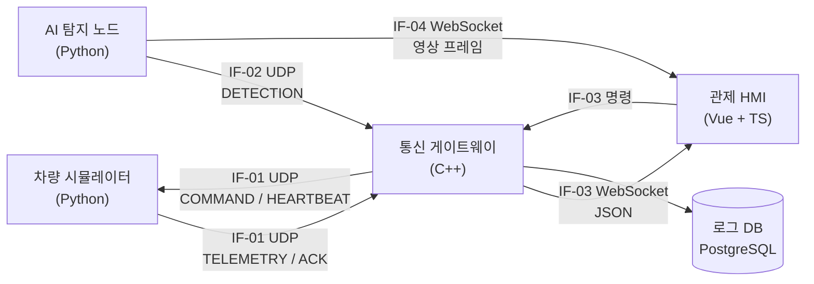

# 소프트웨어 요구사항 명세서 (SRS)

| 항목 | 내용 |
|---|---|
| 문서번호 | UGVC-SRS-001 |
| 시스템 | AI 표적 탐지 기반 UGV 원격 관제 시스템 (가칭 UGVC) |
| 버전 | v0.3 |
| 작성일 | 2026-11-10 |
| 관련 문서 | UGVC-ICD-001 (인터페이스 정의서), UGVC-STP-001 (시험 계획서), ADR-001, ADR-002, GLOSSARY.md |

## 개정 이력

| 버전 | 날짜 | 변경 내용 |
|---|---|---|
| v0.1 | 2026-11-10 | 최초 작성 |
| v0.2 | 2026-11-11 | 구현·시험(STP v0.2)과 독립 리뷰에서 정한 판정 규칙 반영: REQ-COM-003~007 경계·단위 명확화, REQ-SAFE-001 미수신 기준 명확화, REQ-CMD-006 신설(SIM의 범위 밖 명령 처리). 용어 정의는 GLOSSARY.md로 일원화 |
| v0.3 | 2026-11-11 | REQ-COM-008 신설: IF-03 WebSocket 중계와 느린 HMI 격리 (ADR-003 구현). PR #16 리뷰 반영: 뒤처진 HMI는 메시지를 버리는 대신 연결을 끊는다 (지연 상한 2.0s, 대기열 상한) |

---

## 1. 개요

### 1.1 목적
이 문서는 UGVC를 구성하는 소프트웨어 구성요소(CSCI)가 갖추어야 할 기능, 성능, 안전, 품질 요구사항을 정의한다. 각 요구사항은 고유 ID를 가지며, 설계(SDD), 코드, 시험(STP/STR)과 추적표(RTM)로 연결된다.

### 1.2 범위
- 포함: 차량 시뮬레이터, AI 탐지 노드, 통신 게이트웨이, 관제 HMI, 로그 DB
- 제외: 실제 차량 하드웨어, 실제 무선 데이터링크, 보안(암호화·인증) — 향후 확장 항목으로 남긴다

### 1.3 용어

| 용어 | 정의 |
|---|---|
| UGV | 무인지상차량 (Unmanned Ground Vehicle) |
| HMI | 운용자 관제 화면 (Human-Machine Interface) |
| ICD | 인터페이스 정의서 (Interface Control Document) |
| RTB | 복귀 (Return To Base) |
| 송신원 | 게이트웨이에 데이터를 보내는 노드 (차량 시뮬레이터, AI 탐지 노드) |
| 통신 두절 | 송신원의 링크 상태가 LOST인 것 |
| 스트림 | 한 송신원이 보내는 한 종류(msg_type)의 메시지 흐름. seq 순서와 유실은 스트림마다 판정한다 |
| 유효 패킷 | ICD 9장 수신 검증 규칙 9단계를 모두 통과한 패킷 |
| Failsafe | 관제 링크를 잃었을 때 차량이 스스로 안전 상태로 전환하는 동작 |

이 표에 없는 용어와 자세한 정의는 저장소 루트의 GLOSSARY.md를 따른다.

---

## 2. 시스템 개요

| CSCI | 언어 | 역할 |
|---|---|---|
| SIM | Python | 경로점 주행 모사, 텔레메트리 송신, 명령 수행, Failsafe |
| DET | Python | 영상 재생, 객체 탐지, 탐지 결과·영상 프레임 송신 |
| GW | C++17 | 패킷 수신·검증, 링크 상태 판정, HMI 중계, 명령 송신·재전송, 로그 저장 |
| HMI | Vue 3 + TS | 지도·영상·상태 표시, 경고, 명령 입력, 사후 재생 |

---

## 3. 요구사항

**표기 규칙**
- 검증 방법: **T** 시험(Test), **D** 시연(Demonstration), **A** 분석(Analysis), **I** 검사(Inspection)
- 단계: **MVP** = 12월 말까지, **고도화** = 1월 이후

### 3.1 통신 (COM)

| ID | 요구사항 | 검증 | 단계 |
|---|---|---|---|
| REQ-COM-001 | GW는 IF-01로 수신한 TELEMETRY 메시지를 ICD에 따라 파싱하여야 하며, 10Hz 입력을 유실 없이 처리하여야 한다. | T | MVP |
| REQ-COM-002 | GW는 ICD 9장의 검증 규칙을 위반한 패킷을 폐기하고, 위반 원인별 오류 계수를 유지하여야 한다. | T | MVP |
| REQ-COM-003 | GW는 송신원별로 마지막 유효 패킷 수신 후 경과 시간이 0.5초 이상이면 DEGRADED, 1.0초 이상이면 LOST로 링크 상태를 판정하여야 한다. 첫 유효 패킷을 받기 전의 링크 상태는 LOST이다. | T | MVP |
| REQ-COM-004 | GW는 LOST 상태에서 유효 패킷을 다시 수신하면 즉시 CONNECTED로 복귀하고, 상태 전이를 이벤트로 기록하여야 한다. 시작 시 초기 상태(LOST)는 전이가 아니므로 기록하지 않는다. | T | MVP |
| REQ-COM-005 | GW는 스트림별 seq 누락으로 유실 패킷 수를 산출하고, 송신원별 최근 10초 유실률(유실 / (수신 + 유실), 그 송신원의 모든 스트림 합산, 10초 동안 수신·유실이 없으면 값 없음)을 1Hz로 HMI에 제공하여야 한다. 늦게 도착한 패킷은 유실 수를 줄이지 않는다. | T | MVP |
| REQ-COM-006 | GW는 같은 스트림에서 직전에 처리한 seq보다 RFC 1982 순환 비교상 뒤가 아닌 seq(이전이거나 같은 seq)를 가진 패킷을 역순 도착으로 폐기하고 order로 계수하여야 한다. 차이가 정확히 2^31이면 뒤가 아닌 것으로 본다. | T | MVP |
| REQ-COM-007 | GW는 동작하는 동안 차량 링크 상태와 무관하게 IF-01로 HEARTBEAT를 1Hz로 송신하여야 한다. | T | MVP |
| REQ-COM-008 | GW는 IF-03(WebSocket `/ws`)에 접속한 모든 HMI에 IF-03 메시지(ICD 7.1)를 보내야 하며, 새로 접속한 HMI에는 접속 직후 송신원별 현재 link_status와 stats를 보내야 한다. HMI 하나가 메시지를 읽지 않아도 판정 주기, HEARTBEAT 송신, 다른 HMI로의 전달은 멈추지 않아야 한다 (2.0초 넘게 응답이 없거나 송신 대기열 상한을 넘긴 HMI는 연결을 끊는다). | T | MVP |

### 3.2 명령 (CMD)

| ID | 요구사항 | 검증 | 단계 |
|---|---|---|---|
| REQ-CMD-001 | HMI는 모든 명령(정지, 복귀, 경로점 이동)을 운용자 확인 절차를 거친 뒤에만 송신하여야 한다. | D | MVP |
| REQ-CMD-002 | GW는 COMMAND 송신 후 1.0초 안에 ACK를 받지 못하면 같은 cmd_id로 최대 3회 재전송하고, 모두 실패하면 HMI에 TIMEOUT 결과를 전달하여야 한다. | T | MVP |
| REQ-CMD-003 | SIM은 이미 수신한 cmd_id의 COMMAND를 다시 받으면 재실행하지 않고 이전 결과로 ACK만 다시 송신하여야 한다. | T | MVP |
| REQ-CMD-004 | HMI는 차량 링크가 LOST일 때 명령 버튼을 비활성화하고 그 사유를 표시하여야 한다. | D | MVP |
| REQ-CMD-005 | GW는 모든 명령의 송신, 재전송, 결과를 이벤트로 기록하여야 한다. | T | MVP |
| REQ-CMD-006 | SIM은 필드 값이 ICD 6.3 범위를 벗어난 COMMAND(cmd_type이 표 6-4에 없음, WAYPOINT 좌표가 범위 밖)를 실행하지 않고 ACK result REJECTED_INVALID로 응답하여야 한다. cmd_id가 0인 COMMAND는 응답 없이 폐기한다. | T | MVP |

### 3.3 탐지 (AI)

| ID | 요구사항 | 검증 | 단계 |
|---|---|---|---|
| REQ-AI-001 | HMI는 탐지 박스를 같은 frame_id를 가진 영상 프레임 위에만 표시하여야 한다. | D | MVP |
| REQ-AI-002 | HMI는 영상 프레임 수신 후 해당 탐지 결과가 0.5초 안에 도착하지 않으면 박스 없이 영상을 표시하여야 한다. | D | MVP |
| REQ-AI-003 | HMI는 운용자가 신뢰도 임계값을 조정할 수 있어야 하며, 임계값 미만의 탐지는 표시하지 않아야 한다. | D | 고도화 |

### 3.4 관제 화면 (HMI)

| ID | 요구사항 | 검증 | 단계 |
|---|---|---|---|
| REQ-HMI-001 | HMI는 지도 위에 차량의 현재 위치, 진행 방향, 이동 궤적, 경로점을 표시하여야 한다. | D | MVP |
| REQ-HMI-002 | HMI는 속도, 배터리, 운용 모드, 링크 상태, 유실률, 지연 시간을 상태 패널에 표시하여야 한다. | D | MVP |
| REQ-HMI-003 | HMI는 경고를 WARNING, CAUTION, ADVISORY 3단계로 색과 위치를 구분해 표시하고, WARNING과 CAUTION은 운용자가 확인하기 전까지 유지하여야 한다. | D | MVP |
| REQ-HMI-004 | HMI는 표 3-1의 조건에 따라 경고를 발생시켜야 하며, 차량 링크 LOST 경고는 마지막 유효 패킷 수신 후 2.0초 안에 표시되어야 한다. | T | MVP |
| REQ-HMI-005 | HMI는 지도 타일을 로컬에서 제공받아 외부 인터넷 없이 동작하여야 한다. | D | 고도화 |

**표 3-1. 경고 발생 조건**

| 조건 | 등급 |
|---|---|
| 차량 링크 LOST | WARNING |
| 차량 모드 FAULT | WARNING |
| 명령 결과 TIMEOUT 또는 REJECTED | CAUTION |
| 배터리 20% 이하 | CAUTION |
| 탐지 노드 링크 LOST | CAUTION |
| 차량 또는 탐지 노드 링크 DEGRADED | ADVISORY |
| 신규 표적 탐지 | ADVISORY |

### 3.5 기록 (LOG)

| ID | 요구사항 | 검증 | 단계 |
|---|---|---|---|
| REQ-LOG-001 | GW는 유효한 TELEMETRY, DETECTION과 모든 이벤트(링크 상태 전이, 명령, 경고 원인)를 DB에 저장하여야 한다. | T | MVP |
| REQ-LOG-002 | HMI는 저장된 임무를 시간축을 따라 1x, 2x, 4x 배속으로 재생할 수 있어야 한다. (영상은 재생 대상에서 제외, ADR-001 참조) | D | 고도화 |

### 3.6 성능 (PERF)

| ID | 요구사항 | 검증 | 단계 |
|---|---|---|---|
| REQ-PERF-001 | 텔레메트리 송신부터 HMI 화면 반영까지의 지연은 단일 PC 환경에서 95퍼센타일 100ms 이하여야 한다. | T | MVP |
| REQ-PERF-002 | 영상 캡처부터 탐지 박스 표시까지의 지연을 측정해 HMI에 표시하여야 한다. 목표값은 MVP 측정 후 확정한다. (TBD-01) | T | MVP |
| REQ-PERF-003 | GW는 정격 입력으로 30분 연속 동작하는 동안 처리 누락 없이 동작하고, 메모리 사용량이 지속적으로 증가하지 않아야 한다. | T | 고도화 |

### 3.7 안전 (SAFE)

| ID | 요구사항 | 검증 | 단계 |
|---|---|---|---|
| REQ-SAFE-001 | SIM은 HEARTBEAT를 3.0초 이상 수신하지 못하면 스스로 정지(STOPPED)하고, status_flags의 FAILSAFE_ACTIVE를 설정하여야 한다. 시작 후 한 번도 받지 못한 경우는 시작 시각부터 경과 시간을 잰다. | T | MVP |
| REQ-SAFE-002 | SIM은 Failsafe 정지 후 링크가 복구되어도 운용자 명령 없이 주행을 재개하지 않아야 한다. | T | MVP |

### 3.8 품질 (QUAL)

| ID | 요구사항 | 검증 | 단계 |
|---|---|---|---|
| REQ-QUAL-001 | GW의 메시지 직렬화·역직렬화와 검증 규칙은 GoogleTest 단위 시험으로 모든 규칙을 검증하여야 한다. | I | MVP |
| REQ-QUAL-002 | GW 소스는 cppcheck 경고 0건이어야 하며, 예외로 처리한 경고는 사유를 문서화하여야 한다. | I | 고도화 |

---

## 4. 미확정 사항 (TBD)

| ID | 내용 | 확정 시점 |
|---|---|---|
| TBD-01 | 영상-탐지 종단 지연 목표값 | MVP 측정 후 (12월 3주) |
| TBD-02 | 탐지 클래스 목록 (ICD 6.2) | 부트캠프 모델 확정 시 |
