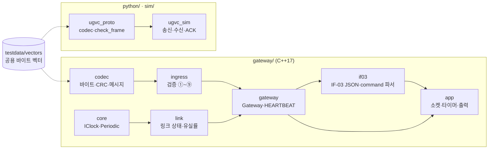
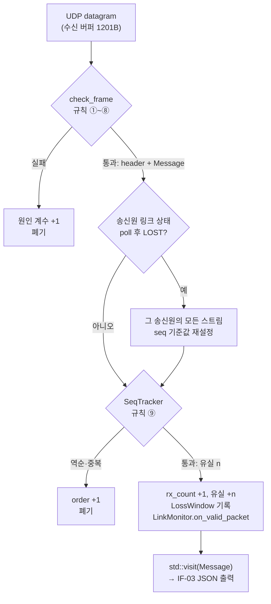
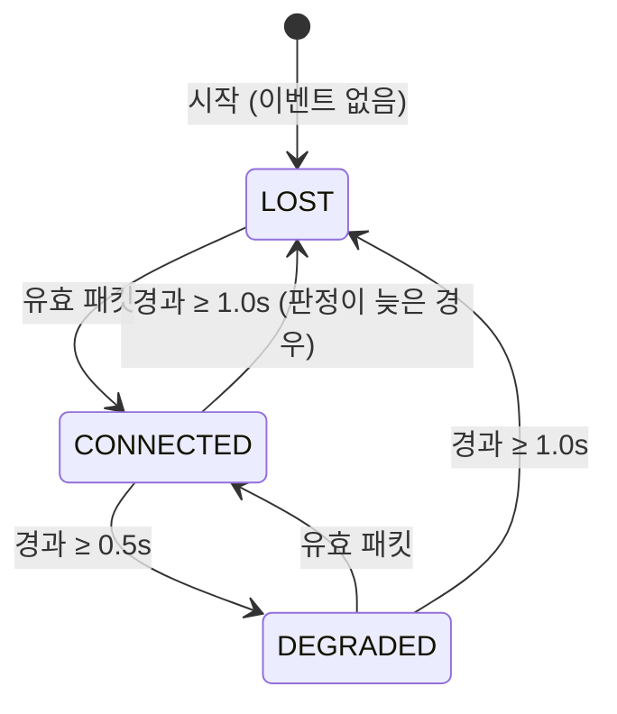
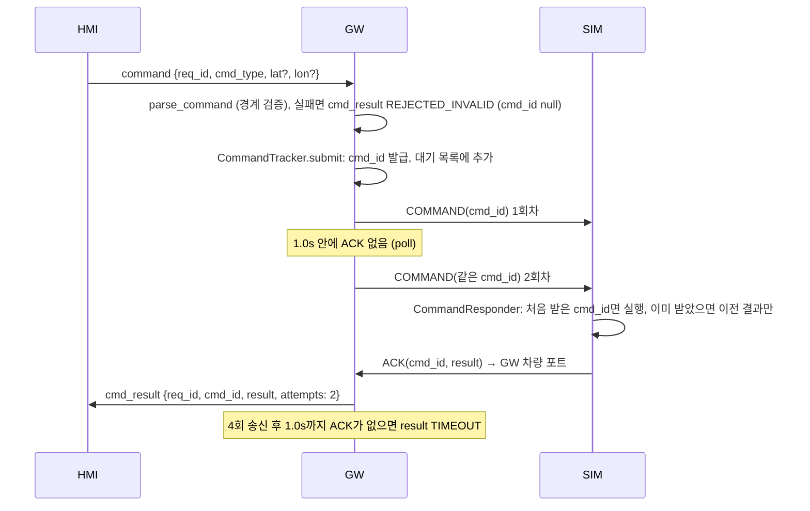
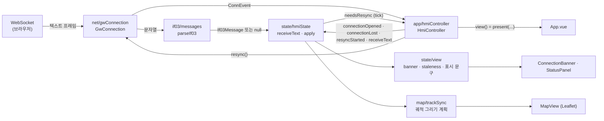
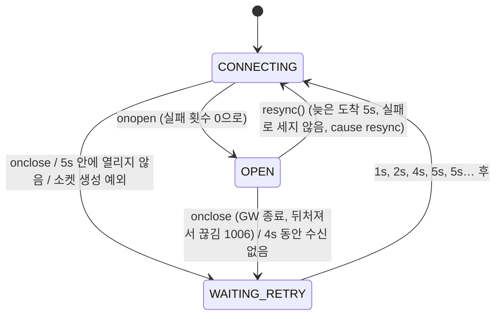

# 소프트웨어 설계 기술서 (SDD)

| 항목 | 내용 |
|---|---|
| 문서번호 | UGVC-SDD-001 |
| 시스템 | AI 표적 탐지 기반 UGV 원격 관제 시스템 (가칭 UGVC) |
| 버전 | v0.3 (초안) |
| 작성일 | 2026-11-11 |
| 관련 문서 | UGVC-SRS-001 v0.5, UGVC-ICD-001 v0.11, UGVC-STP-001 v0.13, ADR-001, ADR-002, ADR-003 |

## 개정 이력

| 버전 | 날짜 | 변경 내용 |
|---|---|---|
| v0.1 | 2026-11-11 | 최초 작성. GW 모듈 구조, 수신 처리 흐름, 링크 상태도, 스레드·시간 구조, 명령 재전송 설계안 |
| v0.1.1 | 2026-11-11 | 5장 출력 구조 변경: stdout·stderr 모두 `LineSink`(출력 전용 스레드)로. O_NONBLOCK 비동기 쓰기가 `2>&1`에서 stderr를 고장 내던 문제(interrogate 검증) 반영 |
| v0.1.2 | 2026-11-11 | 링크 전이를 콜백(`ILinkTransitionSink`)이 아니라 반환값으로: `LinkMonitor`는 `LinkChange`를 반환하고, `Gateway`가 송신원을 붙여 모으면 `app`이 `take_transitions()`로 꺼낸다. `link`가 `ingress`를 몰라도 된다. 1Hz 상태 보고는 순수 함수 `if03::snapshot` |
| v0.1.3 | 2026-11-11 | 5장 WebSocket(IF-03) 세션 구조와 IF-03 발행 경로 (ADR-003 구현, REQ-COM-008). 느린 HMI 연결 종료, 세션 상한, accept 재시도 (PR #16 리뷰). 지연 상한(ping/pong), 세션 상한 경쟁 조건 (PR #16 2차 리뷰). ping 응답 기한을 실제 2.0s로(idle_timeout = 4s), 종료 사유 기록 (3차 리뷰). 관련 문서 버전 갱신 |
| v0.2 | 2026-11-12 | 8장 HMI 구조 신설 (뼈대: IF-03 수신, 상태 갱신, 재접속, 신선도, 지도·상태 패널). 미정 사항은 9장으로 |
| v0.2.1 | 2026-11-12 | 8장 PR #19 리뷰 반영: 신선도·경과 시간을 연결별 시계 기준선으로 상대 판정, GPS_VALID 없는 위치 무시, 궤적 구간 분리와 조각 그리기(실측 근거), 접속 5s·무수신 4s 제한, 표시 정책을 순수 함수 `view.ts`로, 파서 열거값을 `as const` 배열 하나에서 |
| v0.2.2 | 2026-11-12 | 8장 PR #19 3차 리뷰 반영: 연결 범위 상태를 `session`으로 묶고 연결 이벤트를 판별 유니온으로, 늦은 도착 5초 → 재접속(기준선 재설정), stats 없는 연결 2초 → 지연, GPS 무효 10표본부터 궤적 분리, 파서 범위를 ICD 6장 그대로, 궤적 그리기 연산을 `trackSync.planDraw`가 냄, 폐기 수 경로 `receiveText` |
| v0.2.3 | 2026-11-12 | 8장 PR #19 4차 리뷰 반영: `HmiController`(연결 + 상태 + 주기 판정 한곳), 기준선 재설정은 `GwConnection.resync()`(실패로 세지 않음, 연결 끊김 표시 없음), `ConnView` 판별 유니온, 늦음 판정 `isLate` 하나, 궤적 구간 판정 `samplesSinceFix` 하나, 지도 `data-drawn-points`는 실행한 연산으로 셈, 옛 이름 정리 |
| v0.2.4 | 2026-11-12 | 8장 PR #19 5차 리뷰 반영: 접속 시도 이유 `cause`(first·retry·resync), 연결 이벤트 반영은 `HmiController`가(state/는 net/을 모름), 재설정은 궤적을 끊지 않음(`resyncStarted`), 화면 판정 `present()` 하나에 시계 하나, 재접속 카운트다운은 단조 시계, 지도 점 수는 Leaflet 레이어에서 셈, 배너 목록 |
| v0.2.5 | 2026-11-12 | 8장 PR #19 6차 리뷰 반영: 재설정 접속이 1초 넘게 걸리면 궤적을 끊음(`RESYNC_TRACK_GAP_MS`), 재설정 시계는 stats에서만 시작, 상태 패널 문구까지 `present()`에(`LinkRow`·`VehicleRows`), 컨트롤러가 `onChange(View)`로 넘김, 접속 이유 타입을 `model/connection.ts` 하나에, 지도 점 수는 개발 서버 전용 훅으로 |
| v0.2.6 | 2026-11-12 | 8장 PR #19 7차 리뷰 반영: 궤적 끊김을 접속 시간(`RESYNC_TRACK_GAP_MS`, 삭제)이 아니라 텔레메트리 seq 간격으로 판정(`lastTelemetrySeq`), 상태 패널은 `Presented`만 받음(폐기 수 포함), 시연 점검 훅 정리 |
| v0.2.7 | 2026-11-12 | 8장 PR #19 8차 리뷰 반영: 궤적 상태를 `lastFixSeq` 하나로(`samplesSinceFix`·`lastTelemetrySeq` 삭제, 상수 이름 `NO_FIX_GAP_SAMPLES`), 같은 seq 재수신 무시, seq 역행 설명 |
| v0.3 | 2026-11-14 | 6장 명령 재전송을 설계안에서 구현으로(REQ-CMD-002·003·005·006): `CommandTracker`(대기 목록·이벤트 variant), IF-03 `command` 경계 파서, SIM `CommandResponder`. 2장 모듈 표에 반영 |

---

## 1. 범위

이 문서는 통신 게이트웨이(GW, C++17)의 내부 구조를 중심으로, 각 요구사항이 어느 모듈에서 어떻게 구현되는지 설명한다. SIM·DET(Python)는 공용 codec(`python/ugvc_proto`)과의 관계만 다룬다. HMI(Vue 3 + TypeScript)는 8장에서 다룬다.

## 2. 모듈 구조

화살표는 "사용한다" 방향이다. 아래 모듈은 위 모듈을 모른다. `app`만 소켓(Asio)을 쓰고, 나머지는 입출력이 없는 순수 로직이라 단위 시험으로 검증한다.

| 모듈 | 책임 | 주요 타입·함수 | 요구사항 |
|---|---|---|---|
| `codec` | big-endian 필드 직렬화, CRC-16, 헤더·메시지 encode/decode, 열거값 이름(`name_of`)과 범위 상수 | `encode_frame`, `decode_telemetry`, `encode_command`, `Telemetry`, `Detection`, `Command`, `Ack`, `kMsg*` | REQ-QUAL-001, ADR-002 |
| `ingress` | 검증 규칙 ①~⑧(상태 없음), ⑨ seq 순서·유실(스트림별 상태), 폐기 원인 계수 | `check_frame`, `CheckedFrame{header, Message}`, `SeqTracker`, `ErrorCounters` | REQ-COM-001·002·005·006 |
| `core` | 시계 주입, 주기 작업 예정 시각 | `IClock`, `SystemClock`, `Periodic` | (시험 용이성) |
| `link` | 링크 상태 기계(송신원 하나), 10초 유실률 창 | `LinkMonitor`, `LinkChange`, `LossWindow` | REQ-COM-003·004·005 |
| `gateway` | 수신 처리 순서를 묶는 중심 객체, 송신원별 링크 전이 수집, HEARTBEAT 생성, 명령 재전송 추적 | `Gateway::on_datagram`, `Gateway::poll`, `Gateway::take_transitions`, `HeartbeatSender`, `CommandTracker` | REQ-COM-001~007, REQ-CMD-002·005 |
| `if03` | 정수 LSB → 공학 단위, IF-03 JSON 메시지 생성, HMI 명령 경계 검증 | `if03::telemetry`, `stats`, `link_status`, `cmd_result`, `parse_command` | ICD 7.1·7.2 |
| `app` | UDP 수신·송신, 50ms 판정 타이머, stdout·stderr 출력(전용 스레드), 명령행 옵션 | `GatewayApp`, `UdpReceiver`, `LineSink` | REQ-COM-007, REQ-SAFE-001 |

## 3. 수신 처리 흐름

datagram 하나는 `Gateway::on_datagram(source, bytes)` 한 번으로 처리된다. 송신원은 수신 포트로 정해진다 (15001 → VEHICLE, 15002 → DETECTOR).

설계 근거:

- **한 번만 디코딩한다.** 규칙 ⑦(길이)은 디코딩 성공 여부로 판정하고, 그 결과(`Message` = `std::variant<Telemetry, Detection, Ack>`)를 ⑧과 출력이 그대로 쓴다. 원시 포인터를 넘기지 않으므로 수신 버퍼가 재사용돼도 안전하다.
- **규칙 ⑥⑦은 표 데이터다.** `InboundRule{msg_type, source, decode}` 표 한 줄이 "이 송신원이 이 메시지를 보내고, 이렇게 디코딩한다"를 뜻한다. 새 메시지는 표에 한 줄을 추가하고 `in_range` 오버로드 하나를 쓰면 된다. `std::visit`는 처리하지 않은 메시지 타입을 컴파일 오류로 알려 준다.
- **rebase는 ⑨ 직전에 한다.** 50ms 타이머가 아직 돌지 않았더라도 패킷 처리 직전에 링크 상태를 다시 판정하므로, LOST 후 첫 패킷이 항상 기준값이 된다.
- **폐기된 패킷은 링크 타이머를 갱신하지 않는다.** 링크 상태는 유효 패킷만 본다 (GLOSSARY "유효 패킷").

## 4. 링크 상태도

- 상태는 "마지막 유효 패킷 이후 경과 시간"의 함수다. `LinkMonitor`는 매 판정마다 경과 시간으로 상태를 다시 계산하고, 직전 상태와 다를 때만 전이(`LinkChange`)를 **반환**한다 (`[[nodiscard]]`라 버리면 컴파일 경고).
- `Gateway`는 반환된 전이에 송신원을 붙여 `LinkTransition`으로 모은다. `app`은 `on_datagram`·`poll` 직후 `take_transitions()`로 꺼내 stderr 진단과 IF-03 `link_status`로 낸다. 콜백 인터페이스를 쓰지 않으므로 `link`는 송신원(`ingress`)을 모르고, 시험은 반환값만 보면 된다.
- 경과 시간은 `IClock::now()`(steady clock)로 잰다. 시스템 시각이 NTP 보정으로 바뀌어도 판정이 흔들리지 않는다. 기록용 시각만 `epoch_ms()`를 쓴다.
- 판정 지연은 최대 판정 주기(50ms)다. STP 2.2가 이를 허용 오차로 둔다.

## 5. 스레드·시간 구조

GW의 판정은 **단일 스레드 Boost.Asio `io_context` 하나**로 동작한다. 수신·판정·HEARTBEAT·WebSocket 세션이 모두 이 스레드에서 차례로 실행되므로 `Gateway`에는 잠금이 없다. 그 밖의 스레드는 stdout·stderr에 실제로 쓰는 `LineSink` 쓰기 스레드 2개뿐이며, `Gateway` 상태는 만지지 않고 문자열 대기열만 공유한다.

| 이벤트 원천 | 주기 | 하는 일 |
|---|---|---|
| UDP 15001·15002 비동기 수신 | 도착 즉시 | `Gateway::on_datagram`, 유효 TELEMETRY·DETECTION을 IF-03 JSON으로 출력 |
| 판정 타이머 `steady_timer` | 50ms | `Gateway::poll`(링크 재판정) 후 전이 출력, `HeartbeatSender::poll`, `if03::snapshot`(stats·link_status 1Hz) |
| WebSocket 수신 대기·세션 (Boost.Beast, `app::WsServer`) | 도착 즉시 | HMI 접속 시 현재 stats·link_status 송신, HMI 메시지 수신(12월 명령 중계 전까지 기록만), IF-03 메시지 송신 (ADR-003) |

시간 관련 설계:

- **판정 타이머는 예정 시각 기준으로 다시 건다** (`expires_at(expiry() + 50ms)`). `expires_after(50ms)`로 걸면 처리 시간만큼 조금씩 밀려 HEARTBEAT 간격이 약 1003ms가 됐다. 지금은 실측 999.8~1000.1ms다.
- **1Hz 작업은 `Periodic`이 정한다.** 다음 예정 시각을 "예정 시각 + 1s"로 잡아 주기가 밀리지 않고, 호출이 늦어져도 밀린 횟수만큼 몰아서 내지 않는다.

**출력은 막히지 않아야 한다.** io 스레드에서는 어떤 블로킹 쓰기든 판정 주기와 HEARTBEAT를 함께 멈춘다. HEARTBEAT가 3.0초 끊기면 SIM이 Failsafe에 들어간다(REQ-SAFE-001). 그래서 io 스레드는 출력을 상한 있는 대기열에 넣기만 하고, 실제 쓰기는 다른 스레드가 한다.

| 출력 | 방식 | 넘칠 때 |
|---|---|---|
| stdout (JSON Lines) | `LineSink`: 전용 스레드가 블로킹 쓰기, 대기열 1000줄 | 새 줄을 버리고 stderr에 1Hz로 개수 보고 |
| stderr (진단: 링크 전이, 오류, 버림 보고) | `LineSink`: 전용 스레드가 블로킹 쓰기, 대기열 200줄 | 새 줄을 버리고 자리가 나면 개수 보고 |
| WebSocket (IF-03, HMI) | `WsServer`: 세션별 쓰기 대기열 1000개, 비동기 쓰기 (io 스레드), 동시 세션 8개, ping 응답 기한 2.0s | 그 세션의 연결을 끊고 사유를 stderr에 기록한다. HMI는 재접속해 현재 상태부터 받는다 |
| HEARTBEAT (UDP) | `send_to` (UDP는 막히지 않음) | 오류만 stderr에 보고 |

- **읽는 쪽이 사라지면**(EPIPE) 그 뒤 줄은 모두 버린 것으로 센다. SIGPIPE는 무시해 프로세스가 죽지 않는다.
- **O_NONBLOCK 비동기 쓰기를 쓰지 않는 이유:** `dup`한 fd도 원래 fd와 열린 파일 설명(open file description)을 공유한다. 이전 구현은 여기에 O_NONBLOCK을 걸었고, `2>&1`로 같은 설명을 쓰는 stderr까지 non-blocking이 되어 읽는 쪽이 한 번 멈추면 `std::cerr`가 영구히 고장 났다(진단이 조용히 사라짐). 종료 후에도 터미널에 O_NONBLOCK이 남았다. 전용 스레드의 블로킹 쓰기는 fd 플래그를 바꾸지 않는다.
- **IF-03 발행은 한 곳이다.** `GatewayApp::publish`가 메시지를 한 번 직렬화해 `shared_ptr<const string>` 하나로 만들고, stdout `LineSink`와 모든 WebSocket 세션이 그 문자열을 공유한다. 그래서 HMI가 받는 메시지와 통합 시험이 읽는 stdout이 같다 (TC-COM-008-01).
- **느린 HMI는 메시지를 버리지 않고 끊는다.** 메시지를 골라 버리면 HMI 화면에 빈틈이 생긴 채 오래된 데이터를 계속 보여 주게 되므로, 연결을 끊어 HMI가 재접속해 현재 상태부터 받게 한다.
- **끊는 기준은 대기열이 아니라 시간이다 (ping 응답 기한 2.0s).** 처음에는 대기열(1000개)이 넘치면 끊었다. 그런데 2차 리뷰가 실측해 보니, 기본 소켓 버퍼에서는 커널 TCP 버퍼(송신·수신)가 텔레메트리 약 1만 8천~2만 개를 먼저 받아 두었다. 운용 속도(텔레메트리 10Hz + stats·link_status 약 14 msg/s)로는 대기열이 넘치기까지 약 20분이 걸려, 그동안 HMI는 수 분 지난 데이터를 받았다. 그래서 Beast의 WebSocket keep-alive를 지연 상한으로 쓴다. Beast는 `idle_timeout/2`마다 타이머를 돌려, 직전 틱 이후 받은 것이 없으면 ping을 보내고 다음 틱까지도 없으면 끊는다. `idle_timeout = 2 × 2.0s`로 두어 "ping 후 2.0s 안에 응답이 없으면 끊는다"가 되게 했다 (3차 리뷰: 처음에는 `idle_timeout = 2.0s`라 실제 기한이 ping 후 1.0s였고, 1.3s 주기로 답하는 HMI도 끊겼다). 아무것도 보내지 않는 HMI는 무응답 2~4s 사이에 끊긴다 (TC-COM-008-12). 읽지 않는 HMI는 쌓인 데이터 뒤의 ping을 읽지 못하므로 버퍼 크기와 무관하게 끊긴다 (TC-COM-008-11). ping에 1.6s 안에 답하는 HMI는 유지되고 5s 주기로 답하는 HMI는 끊긴다 (TC-COM-008-13·14). 응답 기한 2.0s는 REQ-HMI-004의 경고 표시 예산(2.0s)과 같은 값으로 잡았다. 무응답 탐지는 최대 4s가 걸리므로, HMI 쪽에서도 GW 메시지(1Hz stats)가 끊긴 것을 따로 감시해야 한다 (HMI 설계에서 다룬다).
- **끊을 때마다 사유를 기록한다.** `ws close: lag limit ...`, `ws close: queue full ...`, `ws close: closed by HMI`처럼 한 줄씩 stderr에 남긴다. 사후 분석에서 "GW가 뒤처진 HMI를 끊었다"를 구별할 수 있다 (3차 리뷰).
- **ping 판정이 잡는 것과 못 잡는 것.** Beast는 HMI에게서 받은 바이트가 무엇이든 대기 카운터를 0으로 되돌린다. 그래서 이 판정은 "소켓을 읽지 않고 아무것도 보내지 않는 HMI"만 잡는다. 1초마다 텍스트를 보내면서 읽지 않는 HMI는 10Hz 텔레메트리 아래 15초 동안 끊기지 않았다 (4차 리뷰). 화면 처리가 밀린 브라우저 HMI도 네트워크 계층이 pong을 보내므로 잡지 못한다. 그래서 데이터 신선도는 HMI가 `stats.ts`와 수신 시각으로 직접 감시하고 (ICD 7장), GW 쪽 보장은 TBD-04로 남긴다.
- **대기열 상한(1000개)은 메모리 상한으로 남긴다.** ping 판정보다 짧은 시간에 메시지가 몰리거나, 보내기만 하고 읽지 않는 HMI라면 대기열이 넘쳐 끊긴다 (TC-COM-008-06).
- **핸드셰이크 전 단계도 제한한다.** 업그레이드 요청은 `request_parser<empty_body>`로 헤더 4KB까지만 받고 본문은 받지 않는다. 헤더를 받는 중인 연결은 16개까지이며 넘으면 accept 직후 닫는다. 이전에는 기본 파서가 본문을 1MB까지 받아, 큰 본문을 붙인 요청 400개로 RSS가 4초 만에 5MB → 239MB가 됐다 (4차 리뷰). 지금은 같은 조건에서 5MB로 일정하다 (TC-COM-008-15).
- **메모리 상한:** 세션 8 × 대기열 1000 + 헤더 수신 중 연결 16 × 헤더 4KB (+ 수신 버퍼).
- **세션 상한은 핸드셰이크 중인 연결도 센다.** 상한 검사(HTTP 요청 직후)와 등록(핸드셰이크 완료 후) 사이에 다른 연결의 검사가 끼어들면, 동시에 16개가 들어올 때 대부분이 상한을 통과했다 (2차 리뷰, 20회 중 19회). 검사를 통과하는 순간 자리를 예약하고 핸드셰이크가 끝나면(성공·실패 모두) 예약을 푼다.
- **accept 오류는 100ms 쉬었다가 다시 받는다.** fd가 바닥나면(EMFILE) 곧바로 다시 받아도 같은 오류라, 즉시 재시도하면 CPU를 100% 쓰면서 아무 기록도 남지 않았다 (PR #16 리뷰). 오류는 stderr에 기록한다.
- **WebSocket 세션은 쓰기 스레드를 두지 않는다.** 소켓 쓰기는 Asio 비동기 쓰기(`async_write`)라 io 스레드를 막지 않는다. 멈춘 HMI는 TCP 버퍼가 찬 뒤 그 세션의 쓰기 완료가 오지 않을 뿐이고, 대기열 상한(1000개)이 메모리를 묶는다. 진행 중인 쓰기가 참조하는 문자열을 지우지 않도록, 세션이 닫혀도 대기열을 비우지 않고 `open_` 표시만 내린다.
- **종료:** 소멸 시 남은 줄을 쓰도록 최대 500ms 기다린다. 읽는 쪽이 멈춰 끝나지 않으면 기다리지 않는다(종료가 출력 때문에 막히지 않게).

검증:
- stdout을 아무도 읽지 않아도 40초 동안 HEARTBEAT 40개, 최대 간격 1.02s (`test_REQ_COM_007_heartbeat_continues_when_stdout_reader_stalls`)
- stderr 파이프가 가득 차 있어도 HEARTBEAT 계속 (`test_REQ_COM_007_heartbeat_continues_when_stderr_reader_stalls`)
- `2>&1` 파이프가 멈췄다 돌아와도 링크 전이·버림 보고가 나오고 fd 플래그가 그대로 (`test_diagnostics_survive_shared_pipe_stall`)
- stdout을 읽던 쪽이 닫혀도 버린 줄 보고 (`test_dropped_lines_reported_after_stdout_reader_closes`)
- `LineSink` 단위 시험: 막히지 않음, 쓴 줄 + 버린 줄 = 넣은 줄, EPIPE 계수, fd 플래그 불변

## 6. 명령 재전송 (REQ-CMD-002·003·005·006, ICD 6.3·6.4·7.2·7.3)

### 6.1 GW

- **경계 검증(`if03::parse_command`).** HMI 텍스트는 여기서만 검사하고 `std::variant<CommandRequest, CommandParseError>`로 돌려준다. 예외를 던지지 않는다(`allow_exceptions=false`, 4096바이트 상한). WAYPOINT 좌표는 도 단위 범위를 먼저 검사하고 `llround`로 1e-7 deg 정수로 바꾸므로 int32 넘침이 없다. 실패해도 req_id를 읽었으면 함께 돌려준다 → `app`이 REJECTED_INVALID로 답한다.
- **`CommandTracker`(순수 로직, `IClock` 주입).** 대기 목록의 원소는 `{req_id, Command, sends, last_send}`이다.
  - `submit`: 같은 req_id가 대기 중이면 무시(HMI 재송신 멱등성), 아니면 cmd_id를 발급(1부터, 0 건너뜀)하고 바로 보낼 `Command`를 돌려준다.
  - `poll`(50ms 판정 주기): 마지막 송신 후 1.0s가 지난 원소를 송신 횟수 4 미만이면 다시 보내고, 4이면 TIMEOUT으로 확정해 지운다. 소켓은 모르고 보낼 명령만 돌려준다.
  - `on_ack`: 대기 중인 cmd_id면 표 6-5 result로 확정해 지운다. 늦은 ACK, 모르는 cmd_id, 정의 밖 result는 `UnknownAck`만 낸다(대기 중 명령은 그대로).
  - 이벤트는 `std::variant<CommandSent, CommandResult, UnknownAck>`로 모아 `take_events()`로 꺼낸다. `app`은 `std::visit` + `core::overloaded`로 처리하므로 새 이벤트 종류를 처리하지 않으면 컴파일 오류가 난다(REQ-CMD-005).
- **`app`.** HMI 명령 → `parse_command` → `submit` → COMMAND 송신(COMMAND 전용 seq, HEARTBEAT와 같은 소켓). 유효 ACK(검증 ①~⑨를 통과한 `Message`의 `Ack`) → `on_ack`. 판정 주기 → `poll` 재전송. 매번 이벤트를 꺼내 진단 기록(stderr)에 쓰고, `CommandResult`는 `cmd_result`로 stdout과 모든 HMI에 보낸다. 진단에 쓰는 req_id와 명령 원문은 HMI가 보낸 텍스트이므로 JSON 문자열로 감싸 진단 줄 위조를 막는다.
- **이벤트를 PostgreSQL에 남기는 것**은 로그 작업(REQ-LOG)에서 `drain_command_events`에 붙인다.

### 6.2 SIM

- `parse_uplink`는 COMMAND를 세 가지로 나눈다: cmd_id 0은 폐기(ACK 없음), 필드가 6.3 범위 밖이면 `InvalidCommand`, 그 밖은 `ReceivedCommand`. 별도 형으로 나눠 "범위 밖인데 실행"이 표현되지 않게 했다.
- `CommandResponder`는 최근 1024개 cmd_id의 첫 결과를 `OrderedDict`로 기억한다. 처음이면 `ReceivedCommand`는 ACCEPTED(실행), `InvalidCommand`는 REJECTED_INVALID(실행 안 함). 다시 오면 같은 ACK만 다시 보내고 실행하지 않는다(REQ-CMD-003).
- ACK는 GW 차량 포트(`--gw-port`, 기본 15001)로 보내고 ACK 스트림 전용 seq를 쓴다. `--drop-first N`은 첫 송신 유실을 재현하는 시험용 옵션이다.
- **아직 하지 않은 것:** 실행 결과(`CommandOutcome.execute`)를 주행 모사에 반영하는 일(STOP이면 정지 등). 지금은 텔레메트리 송신과 명령 수신이 별도 프로세스라서, SIM을 한 프로세스로 합치는 Failsafe 작업(REQ-SAFE-001·002)에서 함께 한다.

## 7. 시험 용이성을 위한 설계

| 설계 | 시험에서 얻는 것 |
|---|---|
| 소켓 없는 `Gateway`, 얇은 `app` | 수신 처리 전체를 바이트 배열과 가짜 시계로 단위 시험 (TC-COM-003~006) |
| `IClock` 주입, `FakeClock::advance` | 0.499s / 0.500s 같은 경계값을 실제 대기 없이 시험 |
| `testdata/vectors/*.json`을 C++·Python이 함께 읽음, 생성기는 표준 라이브러리만 사용 | 두 언어 구현이 같은 바이트를 만드는지, 구현과 독립된 기준으로 확인 (ADR-002) |
| GW가 IF-03 JSON을 stdout에도 출력 | WebSocket 없이 통합 시험(pytest가 subprocess로 GW 실행) |
| `tools/check_stp_tests.py` | STP의 테스트 이름이 실제 테스트(C++·Python·HMI vitest)와 어긋나면 실패 (RTM grep의 전제) |
| HMI: 소켓·타이머 주입, 순수 `apply`/`freshness`/`view`/`trackSync` | 재접속 간격, 신선도 경계, 시계 차, 표시 정책을 브라우저 없이 시험 (8.6) |

## 8. HMI 구조

### 8.1 모듈

| 모듈 | 책임 | 요구사항 |
|---|---|---|
| `src/net/gwConnection.ts` | IF-03 접속·끊김 판정·재접속, 기준선 재설정 재접속(`resync`, 실패로 세지 않음). 상태 변화는 판별 유니온 `ConnEvent`로 알린다. 소켓과 타이머는 주입받는다 (`Deps`). 브라우저 WebSocket은 `browserSocket`이 `SocketLike`로 감싼다 | REQ-HMI-006 |
| `src/if03/messages.ts` | IF-03 JSON을 판별 유니온 `If03Message`로 검증. 틀린 메시지와 모르는 type은 `null` | REQ-HMI-007, ICD 7.1 |
| `src/state/hmiState.ts` | `receiveText()`: 파싱 후 반영 또는 폐기 계수. `apply()`: 메시지 하나를 반영한 새 상태. `connectionOpened()`·`connectionLost()`·`resyncStarted()`: 연결 범위 상태(`session`) 시작·폐기(끊김이면 궤적도 끊음, 재설정이면 궤적 유지). `freshness()`: GW 데이터 신선도. `needsResync()`: 기준선 재설정 필요 여부. 전송 층(`net/`)을 모른다 | REQ-HMI-001·002·006·007 |
| `src/state/view.ts` | 표시 정책: 화면용 연결 상태 `ConnView`, 배너 등급·문구, 흐림 범위, 상태 패널 행(`LinkRow`·`VehicleRows`: 경과 시간·유실률·배터리·위치 문구), 이를 한 시각으로 묶은 `present()` | REQ-HMI-002·006 |
| `src/model/connection.ts` | `net/`과 `state/`가 함께 쓰는 접속 이유 타입(`ConnectAttempt`). 두 층은 서로를 import하지 않는다. 그리기 컴포넌트는 `state/view`의 `Presented`만 받는다 | |
| `src/map/trackSync.ts` | 이전에 그린 것과 다음 궤적을 비교해 그리기 연산(`clear`·`newLine`·`extend`) 목록을 낸다 | REQ-HMI-001 |
| `src/app/hmiController.ts` | 연결 + 상태 + 주기 판정 + 화면 판정을 한곳에 묶는다: 텍스트 → `receiveText`, 연결 이벤트 → `connectionOpened`·`connectionLost`·`resyncStarted`와 `ConnView`, `tick()` → `needsResync`면 `resync()`, `view()` → `present()`. 벽시계·단조 시계·소켓·타이머는 주입 | REQ-HMI-006 |
| `src/components/*.vue` | 그리기만 한다. 위 모듈의 결과를 그대로 쓰고 판정하지 않는다 | |

판정은 모두 순수 함수(시각은 인자)와 주입받는 `HmiController`에 있고, 실제 시계(`Date.now`, `performance.now`, 250ms 주기 `tick`)와 WebSocket은 `App.vue`에서 주입한다. 화면 판정(신선도·배너·흐림)은 `present()`가 한 시각으로 한 번에 하므로 App.vue와 시험이 같은 경로를 쓴다.

### 8.2 경계에서 한 번 검증

GW가 보낸 JSON은 `parseIf03`에서만 검사한다.
- 열거값(송신원, 링크 상태, 모드, 플래그, 오류 계수 키)은 `as const` 배열 하나에서 타입과 검사를 함께 만든다. 목록이 둘로 갈라질 수 없다.
- ICD 6장 바이너리 필드의 범위를 공학 단위로 옮겨 그대로 검사한다: 위도 ±90, 경도 ±180, 방향 0~359.99, 속도 0~30, 배터리 0~100 정수, seq·frame_id u32, 이미지 1~4096, 객체 32개 이하, 상자는 이미지 안(x ≤ img_w−1, 1 ≤ w ≤ img_w−x, y·h도 같음), class는 표 6-3, conf·유실률 0~1, 계수는 0 이상 정수, `errors`의 키 7개. LSB 해상도(예: 0.01°)는 검사하지 않는다(GW가 정수 LSB를 나눠 만든 값이므로).
- 결과 객체는 검사한 필드만으로 새로 조립한다(타입 단언 없음). 정의 밖 필드는 버린다.
- 하나라도 맞지 않으면 메시지 전체를 폐기하고 `discarded`로 센다(상태 패널에 표시). GW는 검증 규칙 ⑧로 범위 밖 값을 이미 거르므로, 여기서 걸리는 것은 GW·HMI 버전 불일치 같은 결함이다. 일부 필드만 살려 쓰지 않는다.
- 12월에 `cmd_result`를 다룰 때는 유니온에 변형을 추가한다. `apply()`의 `switch`가 모든 변형을 다루므로, 처리를 빠뜨리면 컴파일 오류(TS2366, 반환값 누락)가 난다.

### 8.3 상태 갱신

- `apply(state, msg, receivedAt)`는 새 객체를 반환한다(이전 상태를 바꾸지 않음). `App.vue`는 이를 `shallowRef`에 통째로 넣는다. 10Hz 텔레메트리마다 깊은 반응성 추적을 하지 않기 위해서다. 실측: 궤적 3000점에서 `apply()` 한 번 6.4µs.
- **위치 유효성:** `GPS_VALID`가 없는 텔레메트리(ICD 표 6-2)는 모드·배터리 등은 갱신하지만 위치(`fix`)와 궤적은 바꾸지 않는다. 지도는 마지막 유효 위치를 회색 화살표로 두고 "위치 무효"를 표시한다.
- **궤적 구간:** 궤적은 구간의 목록이다. 차량 링크 LOST, IF-03 연결 끊김 뒤의 첫 유효 위치와, GPS 무효가 **10표본(10Hz 약 1초) 이상** 이어진 뒤의 첫 유효 위치는 새 구간을 시작한다. 판정은 마지막 유효 위치의 seq(`lastFixSeq`) 하나로 한다: 다음 유효 위치와의 seq 차이 d(u32 순환)에서 d−1이 그 사이 위치 없이 지난 표본(GPS 무효 + 받지 못한 것) 수이고, 이것이 `NO_FIX_GAP_SAMPLES`(10) 이상이면 끊는다. GPS 무효 표본은 아무것도 바꾸지 않는다. 같은 seq가 다시 오면 위치를 다시 붙이지 않는다. seq가 뒤로 가면(차량 LOST 뒤 GW의 기준값 재설정, SIM 재시작) 순환해 큰 차이가 되어 끊긴다. 그래서 유실, 기준선 재설정 접속 대기, 재설정으로 버린 처리 적체가 모두 같은 10표본 규칙으로 판정된다(7차 리뷰: 접속 시간만 보면 적체를 버린 재설정을 놓친다). 연결 끊김·차량 LOST·처음에는 `lastFixSeq`를 null로 둔다(다음 유효 위치는 새 구간). 끊긴 곳을 직선으로 잇지 않는다. GPS 무효 한두 표본으로 끊지 않는 이유: 깜박임마다 끊으면 점 하나짜리 구간만 남고, Leaflet은 점 하나짜리 선을 그리지 않아 궤적이 보이지 않는다(3차 리뷰 재현). 1초 미만의 무효 구간은 직선으로 잇는다.
- **계약(trackSync가 의존):** 점이 늘 때 `apply()`는 마지막 구간 배열만 새로 만들고 다른 구간·점 배열은 그대로 옮긴다. 이 계약이 깨지면 매 점이 전체 다시 그리기가 되는데, 6000점 동안 다시 그리기 횟수를 세는 시험이 이를 잡는다.
- **궤적 상한:** 전체 3000점(10Hz 약 5분). 넘으면 가장 오래된 점부터 300점을 한 번에 지운다. 지도의 다시 그리기를 30초에 한 번으로 묶기 위해서다(8.5). 전체 궤적은 사후 재생(PostgreSQL 로그)에서 본다.
- 링크 상태의 초기값은 GW와 같은 LOST다. 접속 직후 GW가 현재 link_status를 보내므로 곧 실제 값으로 바뀐다(ICD 7장).
- **연결 범위 상태(`session`):** 열린 연결 하나에서만 뜻이 있는 값(연 시각, 기준선, 마지막 stats, 늦음 시작 시각)은 `session: {...} | null` 하나로 묶는다. `HmiController`가 연결 이벤트에 따라 OPEN이면 만들고(`connectionOpened`), 재시도 대기·처음·재시도 접속이면 버리며 궤적을 끊고(`connectionLost`), 기준선 재설정 접속이면 버리기만 한다(`resyncStarted`: 재설정은 연결 끊김이 아니다). 재설정 자체로는 궤적을 끊지 않고, 재설정 동안 빠진 표본은 8.3의 seq 간격 규칙이 판정한다. 화면용 연결 상태 `ConnView`는 판별 유니온이며, 재접속 대기는 단조 시계 기준 예정 시각(`retryAtMono`)을 가진다(벽시계가 바뀌어도 카운트다운이 틀리지 않음). 링크·차량·궤적 값은 "이전 값"으로 남는다.
- **폐기:** `receiveText()`가 파싱에 실패한 메시지를 `discarded`로 센다(상태 패널에 표시).

### 8.4 연결 감시·재접속·신선도 (REQ-HMI-006, ICD 7장)

- 타이머는 한 번에 하나다: 접속 제한 5s, 무수신 제한 4s(메시지를 받을 때마다 다시 잰다), 재접속 대기. GW는 송신원마다 1Hz로 stats를 보내므로 정상이면 4s 무수신은 없다. FIN/RST 없이 GW PC가 사라진 경우를 TCP keepalive보다 빨리 알아챈다.
- 소켓을 버릴 때는 처리기 네 개를 모두 떼고 닫는다. 버린 소켓의 이벤트는 전달되지 않는다. `start()`를 다시 부르면 기존 소켓과 타이머부터 정리한다.
- **신선도 `freshness(state, now)`:** GW와 HMI가 다른 PC일 수 있으므로(`ws://<페이지 호스트>:8080/ws`, GW `--ws-host 0.0.0.0`) GW 시각과 HMI 시각을 직접 빼지 않는다.
  - 연결마다 기준선 `session.baseline` = 관측한 (수신 시각 − `ts`)의 최솟값. 두 PC의 시계 차와 최소 전달 지연이 들어 있다. "늦음"은 `isLate(session)` 한 곳에서 판정한다(신선도와 재설정이 같은 정의를 쓴다).
  - 연결이 없거나, 연결 후 2초 안이고 stats를 아직 받지 못함: WAITING
  - 연결 후 2초가 지나도록 stats 없음(모두 폐기된 경우 포함), 마지막 stats를 받은 지 2초 넘음, 또는 그 stats의 (수신 시각 − `ts`)가 기준선보다 2초 넘게 큼: STALE
  - 그 밖: FRESH
  - **기준선 재설정 시점:** `lateSince`는 기준선보다 늦은 첫 stats의 수신 시각이고(제때 온 stats가 오면 지움), stats가 아닌 메시지로는 시작하지 않는다(기준선을 낮춘 telemetry 하나로 재설정이 앞당겨지지 않게). `tick()`은 0.25초마다 본다(화면이 보일 때. 배경 탭에서는 브라우저가 늦출 수 있다). 그래서 실제 재설정은 늦어지기 시작한 뒤 5초 이상 약 6.25초 이하다(ICD 7장).
- **기준선 재설정:** 기준선은 최솟값이라 줄기만 한다. 시계 계단 변화·drift·비정상적으로 큰 `ts` 하나면 제때 온 stats도 계속 늦게 보이고, 메시지는 계속 오므로 무수신 제한도 걸리지 않는다(3차 리뷰 재현: 40초 넘게 "GW 데이터 지연"). 그래서 stats가 기준선보다 2초 넘게 늦은 상태가 5초 이어지면(`needsResync`) `HmiController.tick()`이 `GwConnection.resync()`를 부른다. `resync()`는 지금 소켓을 닫고 곧바로 다시 접속한다. 실패 횟수를 올리지 않고 재시도 간격을 기다리지 않으며, 이벤트에 `resync` 표지를 달아 배너는 "GW 데이터 지연 · 기준선 재설정 중"(warn)으로 보인다("GW 연결 끊김"이 아님). 새 연결에서 기준선을 새로 잡는다. 재설정 접속이 실패하면 그때부터 보통의 재시도 경로를 탄다. 실제로 HMI 처리가 밀린 경우에도 재접속은 밀린 메시지를 버리고 현재 상태부터 다시 받으므로 같은 조치로 회복된다.
  - 한계(ICD 7장): 접속할 때마다 기준선을 새로 잡으므로, 접속 직후부터 밀려 있던 지연과 일정하게 유지되는 지연은 시계 차와 구분하지 못한다.
- 링크 경과 시간도 같은 기준선으로 GW 시각(`last_rx_ts`)을 HMI 시각으로 바꿔 계산한다(음수가 나오지 않음).
- **표시 정책(`view.ts`):**
  - 배너(접속 시도는 `cause`로 구분):

    | 연결 상태 | 문구 | 등급 |
    |---|---|---|
    | CONNECTING first | GW 접속 중 | warn |
    | CONNECTING retry | GW 연결 끊김 · 재접속 중 | bad |
    | CONNECTING resync | GW 데이터 지연 · 기준선 재설정 중 | warn |
    | WAITING_RETRY | GW 연결 끊김 · N초 후 재접속 (단조 시계로 남은 초) | bad |
    | OPEN, WAITING | GW 연결됨 · 데이터 대기 중 (재설정 뒤 첫 stats 전에도) | warn |
    | OPEN, STALE | GW 데이터 지연 (2초 이상) | bad |
    | OPEN, FRESH | GW 연결됨 | ok |
  - 흐림: GW 연결이 끊겼거나 신선도가 FRESH가 아니면 패널 전체를, 그에 더해 차량 링크가 CONNECTED가 아니면 차량 섹션("이전 값")과 지도 마커를 흐리게 한다
  - 배터리 경고색은 SIM이 정한 `BATTERY_LOW` 플래그(20% 이하)를 따른다. HMI가 따로 문턱을 두지 않는다
  - 정식 경고(REQ-HMI-003·004)는 경고 체계 작업에서 이 판정들을 입력으로 쓴다

### 8.5 지도

- Leaflet. 타일 주소는 빌드 변수 `VITE_TILE_URL`로 받는다. 없으면 타일 없이 격자 배경만 그린다(외부 인터넷 없이 동작. 오프라인 타일 제공은 REQ-HMI-005 고도화).
- 차량은 `heading_deg`만큼 회전한 화살표로 그린다. 아이콘은 한 번만 만들고, 이후에는 회전(`transform`)과 상태 클래스(흐림, 위치 무효)만 바꾼다. 기본은 차량을 따라 지도를 옮기고, 운용자가 지도를 끌면 따라가기를 끈다("차량 따라가기" 버튼으로 다시 켬).
- **궤적 그리기:** Leaflet은 점을 하나 덧붙여도(`addLatLng`) polyline 전체를 다시 투영한다. chromium 실측 결과:

  | 방법 | 호출당 |
  |---|---|
  | 3000점 SVG polyline `setLatLngs` | 8.7ms |
  | 3000점 SVG polyline `addLatLng` | 16.7ms |
  | 3000점 Canvas polyline `addLatLng` | 14.7ms |
  | 200점 SVG polyline `addLatLng` | 0.14ms |

  그래서 궤적을 200점 이하 조각(끝점 공유)으로 나눠 그리고, 새 점은 마지막 조각에만 덧붙인다. `trackSync.planDraw(drawn, track)`가 그리기 연산(`clear`, `newLine(points)`, `extend(point)`)과 다음 `drawn`(비교 기준 궤적, 마지막 조각의 점 수)을 낸다. 조각 경계와 이음점도 여기서 정하므로 `MapView`는 연산을 실행만 한다. 다시 그리기는 앞쪽 삭제(301점마다, 10Hz면 약 30초에 한 번)에만 일어난다.
- 시연 점검이 렌더러와 무관하게 확인할 수 있도록, 개발 서버에서만 `window.__ugvcTrackPoints()`(Leaflet 궤적 레이어의 polyline들에 실제로 들어 있는 점 수, 조각 이음점 포함)를 두고 지도 요소에 `data-heading`을 둔다. 점 수는 그릴 때마다 세지 않고 점검 스크립트가 부를 때만 센다. `extend`할 선이 없으면 계획과 실행이 어긋난 결함이므로 예외로 드러낸다.

### 8.6 시험

| 대상 | 방법 |
|---|---|
| `parseIf03` | `hmi/tests/fixtures/gw_if03_sample.jsonl`(실제 GW 출력: 위치 유효·무효 telemetry, detection, stats, link_status)을 그대로 넣어 본다. 이 표본은 `capture_gw_if03.py`가 GW를 실행해 만든다. 표본은 생성 시점의 형식이므로, GW의 IF-03 형식을 바꾸면 스크립트를 다시 돌린다. 현재 GW와의 일치는 시연 점검(실제 GW 출력이 파서를 거쳐야 화면이 ok가 됨)이 매번 확인한다 |
| `HmiController` | 가짜 소켓·타이머·벽시계·단조 시계(ms 단위)로 늦음 → 재설정(첫 늦은 stats부터 5~5.25초, 계단부터 ≤6.25초, 계단 위상 4가지) → 새 기준선 FRESH 전체 순환, 느린 재설정 접속은 궤적 분리, 단조 시계 카운트다운, 진짜 끊김 뒤 궤적 분리, 상태 패널 행. 경계값은 코드 상수가 아니라 ICD 값으로 확인 |
| `receiveText`, `apply`, `freshness`, `needsResync`, `view`, `trackSync` | 순수 함수. 시각을 인자로 넘겨 2000ms 경계·시계 차·계단 변화를 대기 없이 시험. `planDraw` 연산을 실행한 결과가 상태 궤적과 같은지 무작위 8000메시지로 확인 |
| `GwConnection` | 가짜 소켓·가짜 타이머로 재접속 간격, 접속·무수신 제한, 예외, stop·재시작 시험 |
| 화면 | `hmi/e2e/smoke.mjs`: 실제 GW·SIM·HMI(vite)와 Playwright로 시연 점검(STP 수준 D). 화면 속성(`data-level`, `data-stale`, `data-heading`)과 개발 서버 훅(`__ugvcTrackPoints`)으로 판정하고, `--clock-skew`로 시계 차가 있는 배치와, 실행 중 시계 +3초 계단 변화 뒤 회복(GW WebSocket 재접속 정확히 1회, `MutationObserver`로 기록한 배너 변화에 "기준선 재설정 중"이 있고 "GW 연결 끊김"이 없음)도 확인 |

## 9. 미정 사항

| 항목 | 정할 때 |
|---|---|
| HMI 영상·탐지 매칭 버퍼 (ADR-001, frame_id, 0.5s) | 12월 3주 DET 연결 |
| PostgreSQL 저장 방식(동기·비동기, 배치) | 12월 1–2주. 단일 스레드를 막지 않는 방식이어야 한다 (5장) |
| REQ-HMI-004 2.0s 측정 구간과 방법 | HMI 경고 구현 주, STP에 추가 |
