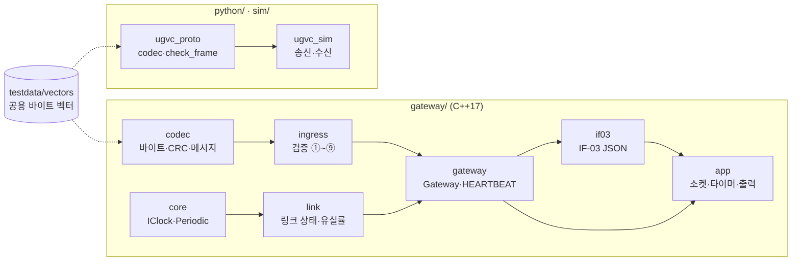
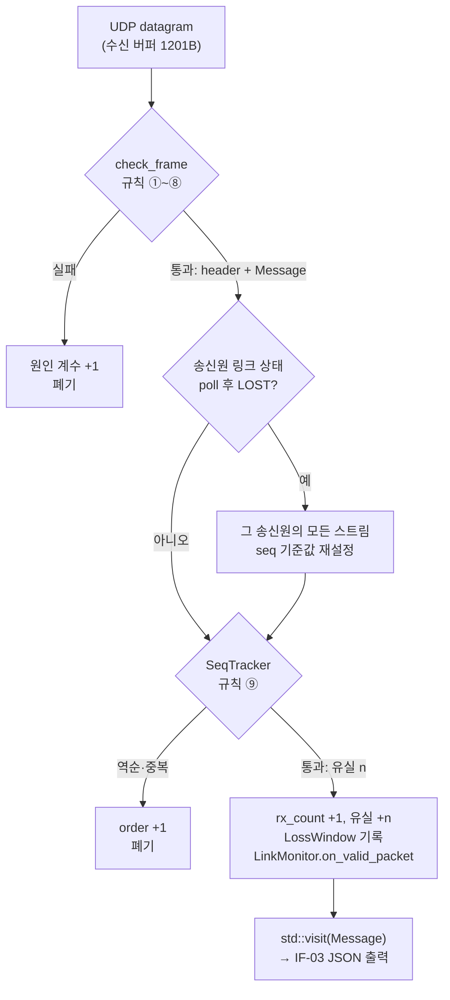
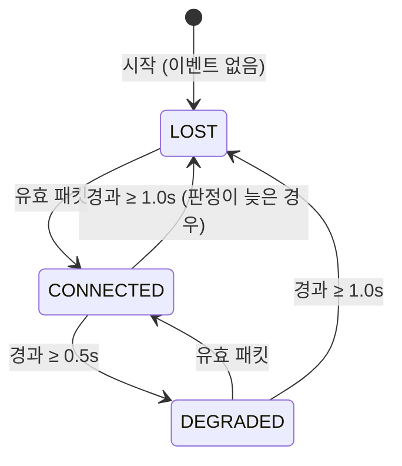
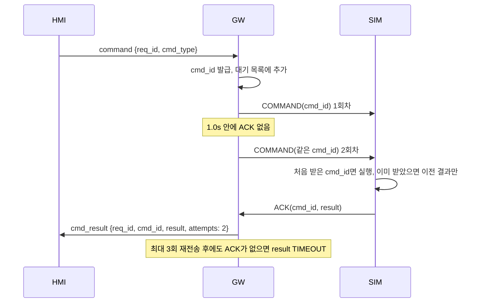

# 소프트웨어 설계 기술서 (SDD)

| 항목 | 내용 |
|---|---|
| 문서번호 | UGVC-SDD-001 |
| 시스템 | AI 표적 탐지 기반 UGV 원격 관제 시스템 (가칭 UGVC) |
| 버전 | v0.1.2 (초안) |
| 작성일 | 2026-11-11 |
| 관련 문서 | UGVC-SRS-001 v0.2, UGVC-ICD-001 v0.2, UGVC-STP-001, ADR-001, ADR-002, ADR-003 |

## 개정 이력

| 버전 | 날짜 | 변경 내용 |
|---|---|---|
| v0.1 | 2026-11-11 | 최초 작성. GW 모듈 구조, 수신 처리 흐름, 링크 상태도, 스레드·시간 구조, 명령 재전송 설계안 |
| v0.1.1 | 2026-11-11 | 5장 출력 구조 변경: stdout·stderr 모두 `LineSink`(출력 전용 스레드)로. O_NONBLOCK 비동기 쓰기가 `2>&1`에서 stderr를 고장 내던 문제(interrogate 검증) 반영 |
| v0.1.2 | 2026-11-11 | 링크 전이를 콜백(`ILinkTransitionSink`)이 아니라 반환값으로: `LinkMonitor`는 `LinkChange`를 반환하고, `Gateway`가 송신원을 붙여 모으면 `app`이 `take_transitions()`로 꺼낸다. `link`가 `ingress`를 몰라도 된다. 1Hz 상태 보고는 순수 함수 `if03::snapshot` |

---

## 1. 범위

이 문서는 통신 게이트웨이(GW, C++17)의 내부 구조를 중심으로, 각 요구사항이 어느 모듈에서 어떻게 구현되는지 설명한다. SIM·DET(Python)는 공용 codec(`python/ugvc_proto`)과의 관계만 다룬다. HMI 설계는 11/24 주에 추가한다.

## 2. 모듈 구조

화살표는 "사용한다" 방향이다. 아래 모듈은 위 모듈을 모른다. `app`만 소켓(Asio)을 쓰고, 나머지는 입출력이 없는 순수 로직이라 단위 시험으로 검증한다.

| 모듈 | 책임 | 주요 타입·함수 | 요구사항 |
|---|---|---|---|
| `codec` | big-endian 필드 직렬화, CRC-16, 헤더·메시지 encode/decode, 열거값 이름(`name_of`)과 범위 상수 | `encode_frame`, `decode_telemetry`, `Telemetry`, `Detection`, `Ack`, `kMsg*` | REQ-QUAL-001, ADR-002 |
| `ingress` | 검증 규칙 ①~⑧(상태 없음), ⑨ seq 순서·유실(스트림별 상태), 폐기 원인 계수 | `check_frame`, `CheckedFrame{header, Message}`, `SeqTracker`, `ErrorCounters` | REQ-COM-001·002·005·006 |
| `core` | 시계 주입, 주기 작업 예정 시각 | `IClock`, `SystemClock`, `Periodic` | (시험 용이성) |
| `link` | 링크 상태 기계(송신원 하나), 10초 유실률 창 | `LinkMonitor`, `LinkChange`, `LossWindow` | REQ-COM-003·004·005 |
| `gateway` | 수신 처리 순서를 묶는 중심 객체, 송신원별 링크 전이 수집, HEARTBEAT 생성 | `Gateway::on_datagram`, `Gateway::poll`, `Gateway::take_transitions`, `HeartbeatSender` | REQ-COM-001~007 |
| `if03` | 정수 LSB → 공학 단위, IF-03 JSON 메시지 생성 | `if03::telemetry`, `stats`, `link_status` | ICD 7.1 |
| `app` | UDP 수신·송신, 50ms 판정 타이머, stdout·stderr 출력(전용 스레드), 명령행 옵션 | `GatewayApp`, `UdpReceiver`, `LineSink` | REQ-COM-007, REQ-SAFE-001 |

## 3. 수신 처리 흐름

datagram 하나는 `Gateway::on_datagram(source, bytes)` 한 번으로 처리된다. 송신원은 수신 포트로 정해진다 (15001 → VEHICLE, 15002 → DETECTOR).

설계 근거:

- **한 번만 디코딩한다.** 규칙 ⑦(길이)은 디코딩 성공 여부로 판정하고, 그 결과(`Message` = `std::variant<Telemetry, Detection, Ack>`)를 ⑧과 출력이 그대로 쓴다. 원시 포인터를 넘기지 않으므로 수신 버퍼가 재사용돼도 안전하다.
- **규칙 ⑥⑦은 표 데이터다.** `InboundRule{msg_type, source, decode}` 표 한 줄이 "이 송신원이 이 메시지를 보내고, 이렇게 디코딩한다"를 뜻한다. 새 메시지는 표에 한 줄을 추가하고 `in_range` 오버로드 하나를 쓰면 된다. `std::visit`는 처리하지 않은 메시지 타입을 컴파일 오류로 알려 준다.
- **rebase는 ⑨ 직전에 한다.** 50ms 타이머가 아직 돌지 않았더라도 패킷 처리 직전에 링크 상태를 다시 판정하므로, LOST 후 첫 패킷이 항상 기준값이 된다.
- **폐기된 패킷은 링크 타이머를 갱신하지 않는다.** 링크 상태는 유효 패킷만 본다 (GLOSSARY "유효 패킷").

## 4. 링크 상태도

- 상태는 "마지막 유효 패킷 이후 경과 시간"의 함수다. `LinkMonitor`는 매 판정마다 경과 시간으로 상태를 다시 계산하고, 직전 상태와 다를 때만 전이(`LinkChange`)를 **반환**한다 (`[[nodiscard]]`라 버리면 컴파일 경고).
- `Gateway`는 반환된 전이에 송신원을 붙여 `LinkTransition`으로 모은다. `app`은 `on_datagram`·`poll` 직후 `take_transitions()`로 꺼내 stderr 진단과 IF-03 `link_status`로 낸다. 콜백 인터페이스를 쓰지 않으므로 `link`는 송신원(`ingress`)을 모르고, 시험은 반환값만 보면 된다.
- 경과 시간은 `IClock::now()`(steady clock)로 잰다. 시스템 시각이 NTP 보정으로 바뀌어도 판정이 흔들리지 않는다. 기록용 시각만 `epoch_ms()`를 쓴다.
- 판정 지연은 최대 판정 주기(50ms)다. STP 2.2가 이를 허용 오차로 둔다.

## 5. 스레드·시간 구조

GW의 판정은 **단일 스레드 Asio `io_context` 하나**로 동작한다. 수신·판정·HEARTBEAT가 모두 이 스레드에서 차례로 실행되므로 `Gateway`에는 잠금이 없다. 그 밖의 스레드는 stdout·stderr에 실제로 쓰는 `LineSink` 쓰기 스레드 2개뿐이며, `Gateway` 상태는 만지지 않고 문자열 대기열만 공유한다.

| 이벤트 원천 | 주기 | 하는 일 |
|---|---|---|
| UDP 15001·15002 비동기 수신 | 도착 즉시 | `Gateway::on_datagram`, 유효 TELEMETRY·DETECTION을 IF-03 JSON으로 출력 |
| 판정 타이머 `steady_timer` | 50ms | `Gateway::poll`(링크 재판정) 후 전이 출력, `HeartbeatSender::poll`, `if03::snapshot`(stats·link_status 1Hz) |
| (11/24 주) WebSocket 세션 | 도착 즉시 | HMI 명령 수신, IF-03 메시지 송신 (ADR-003) |

시간 관련 설계:

- **판정 타이머는 예정 시각 기준으로 다시 건다** (`expires_at(expiry() + 50ms)`). `expires_after(50ms)`로 걸면 처리 시간만큼 조금씩 밀려 HEARTBEAT 간격이 약 1003ms가 됐다. 지금은 실측 999.8~1000.1ms다.
- **1Hz 작업은 `Periodic`이 정한다.** 다음 예정 시각을 "예정 시각 + 1s"로 잡아 주기가 밀리지 않고, 호출이 늦어져도 밀린 횟수만큼 몰아서 내지 않는다.

**출력은 막히지 않아야 한다.** io 스레드에서는 어떤 블로킹 쓰기든 판정 주기와 HEARTBEAT를 함께 멈춘다. HEARTBEAT가 3.0초 끊기면 SIM이 Failsafe에 들어간다(REQ-SAFE-001). 그래서 io 스레드는 출력을 상한 있는 대기열에 넣기만 하고, 실제 쓰기는 다른 스레드가 한다.

| 출력 | 방식 | 넘칠 때 |
|---|---|---|
| stdout (JSON Lines) | `LineSink`: 전용 스레드가 블로킹 쓰기, 대기열 1000줄 | 새 줄을 버리고 stderr에 1Hz로 개수 보고 |
| stderr (진단: 링크 전이, 오류, 버림 보고) | `LineSink`: 전용 스레드가 블로킹 쓰기, 대기열 200줄 | 새 줄을 버리고 자리가 나면 개수 보고 |
| WebSocket (11/24 주) | 세션별 쓰기 대기열 | 그 세션의 메시지만 버리고 계수 (ADR-003) |
| HEARTBEAT (UDP) | `send_to` (UDP는 막히지 않음) | 오류만 stderr에 보고 |

- **읽는 쪽이 사라지면**(EPIPE) 그 뒤 줄은 모두 버린 것으로 센다. SIGPIPE는 무시해 프로세스가 죽지 않는다.
- **O_NONBLOCK 비동기 쓰기를 쓰지 않는 이유:** `dup`한 fd도 원래 fd와 열린 파일 설명(open file description)을 공유한다. 이전 구현은 여기에 O_NONBLOCK을 걸었고, `2>&1`로 같은 설명을 쓰는 stderr까지 non-blocking이 되어 읽는 쪽이 한 번 멈추면 `std::cerr`가 영구히 고장 났다(진단이 조용히 사라짐). 종료 후에도 터미널에 O_NONBLOCK이 남았다. 전용 스레드의 블로킹 쓰기는 fd 플래그를 바꾸지 않는다.
- **종료:** 소멸 시 남은 줄을 쓰도록 최대 500ms 기다린다. 읽는 쪽이 멈춰 끝나지 않으면 기다리지 않는다(종료가 출력 때문에 막히지 않게).

검증:
- stdout을 아무도 읽지 않아도 40초 동안 HEARTBEAT 40개, 최대 간격 1.02s (`test_REQ_COM_007_heartbeat_continues_when_stdout_reader_stalls`)
- stderr 파이프가 가득 차 있어도 HEARTBEAT 계속 (`test_REQ_COM_007_heartbeat_continues_when_stderr_reader_stalls`)
- `2>&1` 파이프가 멈췄다 돌아와도 링크 전이·버림 보고가 나오고 fd 플래그가 그대로 (`test_diagnostics_survive_shared_pipe_stall`)
- stdout을 읽던 쪽이 닫혀도 버린 줄 보고 (`test_dropped_lines_reported_after_stdout_reader_closes`)
- `LineSink` 단위 시험: 막히지 않음, 쓴 줄 + 버린 줄 = 넣은 줄, EPIPE 계수, fd 플래그 불변

## 6. 명령 재전송 (설계안, 12월 1–2주 구현)

REQ-CMD-002·003·005·006을 위한 설계안이다. 구현할 때 이 절을 갱신한다.

- `CommandTracker`(가칭)를 `gateway` 모듈에 둔다. `IClock`을 받아 재전송 시각을 판정하고, 50ms 판정 타이머의 `poll()`에서 재전송·TIMEOUT을 낸다. 가짜 시계로 1.0s 경계와 3회 상한을 시험한다.
- ACK는 이미 검증 단계에서 `Message`의 `Ack`로 디코딩되어 나온다. `app`은 이를 `CommandTracker`에 넘기기만 한다. `Gateway::on_datagram`에 명령 로직을 섞지 않는다.
- 명령 이벤트(송신, 재전송, 결과)도 링크 전이처럼 반환값으로 모아 `app`이 꺼낸다. 이벤트 종류가 둘 이상이 되면 `std::variant<LinkTransition, CommandEvent>`로 묶어 `std::visit`이 처리 누락을 컴파일 오류로 알리게 한다 (REQ-CMD-005, PostgreSQL 로그와 연결).
- SIM은 받은 cmd_id와 결과를 기억해 중복 cmd_id를 재실행하지 않는다(REQ-CMD-003). 범위를 벗어난 명령은 실행하지 않고 `REJECTED_INVALID`로 ACK한다(REQ-CMD-006).

## 7. 시험 용이성을 위한 설계

| 설계 | 시험에서 얻는 것 |
|---|---|
| 소켓 없는 `Gateway`, 얇은 `app` | 수신 처리 전체를 바이트 배열과 가짜 시계로 단위 시험 (TC-COM-003~006) |
| `IClock` 주입, `FakeClock::advance` | 0.499s / 0.500s 같은 경계값을 실제 대기 없이 시험 |
| `testdata/vectors/*.json`을 C++·Python이 함께 읽음, 생성기는 표준 라이브러리만 사용 | 두 언어 구현이 같은 바이트를 만드는지, 구현과 독립된 기준으로 확인 (ADR-002) |
| GW가 IF-03 JSON을 stdout에도 출력 | WebSocket 없이 통합 시험(pytest가 subprocess로 GW 실행) |
| `tools/check_stp_tests.py` | STP의 테스트 이름이 실제 테스트와 어긋나면 실패 (RTM grep의 전제) |

## 8. 미정 사항

| 항목 | 정할 때 |
|---|---|
| HMI 구조(상태 관리, 영상·탐지 매칭 버퍼) | 11/24 주 HMI 뼈대 |
| PostgreSQL 저장 방식(동기·비동기, 배치) | 12월 1–2주. 단일 스레드를 막지 않는 방식이어야 한다 (5장) |
| REQ-HMI-004 2.0s 측정 구간과 방법 | HMI 경고 구현 주, STP에 추가 |
